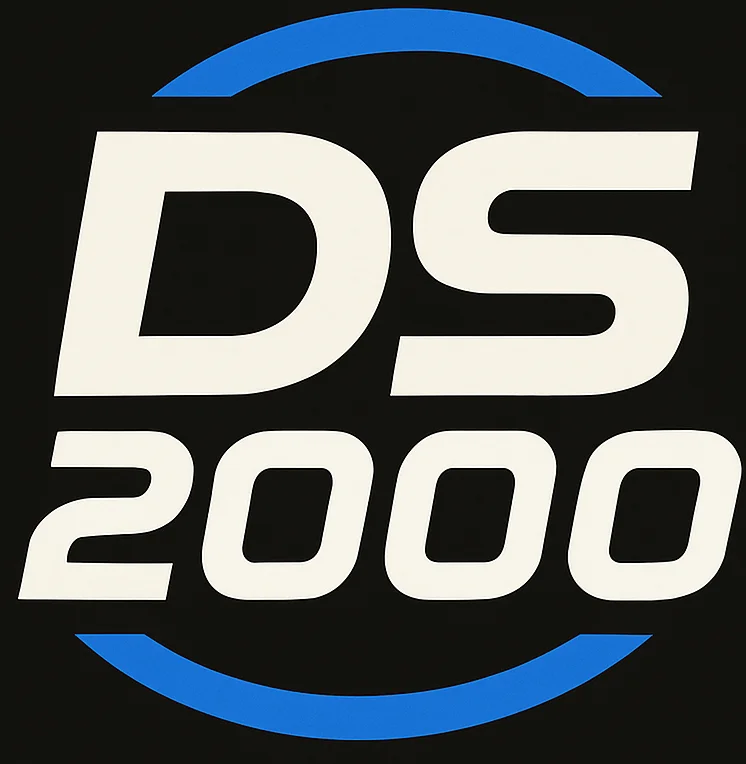

<p align="center">
  
</p>

# DS2000

Desktop app for the DS2000, a small desk device with three keys (mute, deafen, disconnect) and two
RGB status LEDs. The app links the device to Discord: the keys control your voice state, and the
LEDs show it.

It runs on Windows. Built with Rust and Tauri 2, with a plain HTML, CSS and JavaScript frontend.

## Features

- **Discord voice control** from the device: mute, deafen, and leave the voice channel. The device
  LEDs follow your mute and deafen state, including changes made in Discord itself.
- **RGB lighting**: rainbow, fixed or breathing, with brightness, speed and a colour per LED.
- **Tray app**: closing the window keeps it running in the tray. Optional start with Windows,
  optionally minimised.
- **Automatic device detection** over USB.
- **English and Spanish** interface.

## Install

Download the `.msi` from the [latest release](https://github.com/Mechanix97/DS2000/releases/latest)
and run it.

The installer is unsigned, so SmartScreen warns the first time: **More info → Run anyway**.
To check the download, `Get-FileHash <file>.msi` in PowerShell must match the SHA-256 in the
release notes.

The device firmware has to speak the same serial protocol as the app; each release says which one.
If they do not match, **Settings → Connections** says whether the firmware or the app is out of date. The
firmware lives in [DS2000-Firmware](https://github.com/Mechanix97/DS2000-Firmware).

## Connect Discord

Discord only lets an application control your microphone if you own that application, so DS2000
does not ship one: you create your own. It is free and done once. You need the Discord **desktop**
app running; the browser version cannot be controlled.

1. Open the [Discord Developer Portal](https://discord.com/developers/applications) and click
   **New Application**. Any name works, for example "DS2000".
2. Go to **OAuth2**:
   - Copy the **Client ID**.
   - Click **Reset Secret** and copy the **Client Secret**. Discord shows it only once.
   - Under **Redirects**, add exactly `http://localhost/` and save. Without it the connection
     fails.
3. In DS2000, open the **Discord** tab, paste both values and click **Connect**.
4. Discord shows an authorisation request: accept it.

The Discord tab then reads *Connected to Discord.*, and **Settings → Connections** reads *Discord: Connected*. Your credentials survive restarts; **Unlink** in the
same tab removes them.

## Using it

| Key | Does |
|---|---|
| Mute | Toggles mute |
| Deafen | Toggles deafen |
| Disconnect | Leaves the current voice channel |

The microphone and headphone icons in the app toggle mute and deafen too.

Tabs:

- **RGB**: mode (rainbow, fixed, breathing), brightness, speed, and the colour of each LED.
  Changes reach the device immediately and are remembered.
- **Discord**: the credentials above.
- **Settings**: start with Windows, start minimised, language, and the connection status.
- **About**: app and firmware versions, and links.

The tray icon opens the window on a left click; its menu has **Open DS2000** and **Quit**. Closing
the window does not quit the app.

## Where things are stored

| What | Where |
|---|---|
| Settings (Discord client id, RGB, language, startup options, last port) | `%APPDATA%\Mechardo\config.json` |
| Discord client secret and tokens | Windows Credential Manager, service `DS2000` |

No secret is written to the config file.

## Development

Requirements: Windows, [Rust](https://rustup.rs/) (the toolchain is pinned to 1.88 by
`rust-toolchain.toml`, rustup picks it up), Node.js 18 or later, and `make`.

```bash
git clone https://github.com/Mechanix97/DS2000.git
cd DS2000
make deps   # tauri-cli if missing, and the frontend's npm packages
make run    # cargo tauri dev: Vite with hot reload plus the Rust backend
```

| Command | Does |
|---|---|
| `make run` / `make run-debug` | Run the app, with `info` or `debug` logging |
| `make lint` | `cargo clippy --workspace --all-targets --all-features -- -D warnings` |
| `make test` | `cargo test --workspace` |
| `make test-hardware` | The `#[ignore]`d tests that need the device or Discord |
| `make build-installer-windows` | Build the MSI locally |

CI runs format, lint and tests on every pull request. Pushing a `v*` tag builds the MSI and attaches
it to a draft release. The version comes from `src-tauri/Cargo.toml`.

Logging uses `RUST_LOG`, for example `RUST_LOG=serial=debug,discord=info`.

### Layout

```
src-tauri/
├── src/
│   ├── main.rs              # Tauri setup, tray, window, single instance, autostart
│   ├── controller/          # Tauri commands; the coordinator links device events and Discord
│   ├── backend/discord/     # Discord local RPC over the IPC pipe, OAuth
│   ├── backend/serial/      # Device discovery, framing and messages
│   ├── config/              # config.json, keyring credentials, language
│   └── common/              # Types shared by the crates
├── frontend/                # index.html, JS modules, translations/{en,es}.json
└── tauri.conf.json
docs/PROTOCOL.md             # Serial protocol shared with the firmware
```

The serial protocol between the app and the firmware is specified in
[docs/PROTOCOL.md](docs/PROTOCOL.md). Any change to it follows the procedure described there, with
paired pull requests in this repository and the firmware's.

## Contributing

Issues and pull requests are welcome. Branch from `main` and open a pull request; `main` is never
pushed to directly. Before opening it, run `cargo fmt`, `make lint` and `make test`. Commit
messages follow [Conventional Commits](https://www.conventionalcommits.org/) (`feat:`, `fix:`,
`docs:`, ...). For a bug, include the steps, what you expected, and a log from `make run-debug`.

## Related projects

- [DS2000-Firmware](https://github.com/Mechanix97/DS2000-Firmware): device firmware (RP2350, Arduino)
- [DS2000-PCB](https://github.com/Mechanix97/DS2000-PCB): KiCad board
- [DS2000-Enclosure](https://github.com/Mechanix97/DS2000-Enclosure): 3D-printed enclosure

## License

[GNU Affero General Public License v3.0](LICENSE).

Made by [Mechardo Labs](https://www.mechardo3d.xyz/). Community on
[Discord](https://discord.gg/VtbFAGJe86).

DS2000 is not affiliated with or endorsed by Discord Inc.
